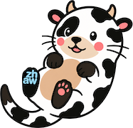

<p align="center"></p>

# lingoSwen

A private, system-wide translation and language-tutoring agent for macOS,
powered entirely by a local LLM running on [Ollama](https://ollama.com).

Highlight text anywhere in macOS, hit a hotkey, and get a translation,
a correction, or an explanation — without a single byte of your writing
leaving your machine.

> lingoSwen was called babelOtter until October 2026. The repository, the Swift
> package and its modules (`BabelOtterKit`, `BabelOtterApp`, `babelotter-eval`)
> keep the old name; the app you run is lingoSwen.

> **Status: M1b nearly done.** M1a's pipeline — capture, language detection,
> structure preservation, prompt building, streaming, response parsing, config —
> is on `main`, with the privacy mechanisms below and a CI pipeline that gates on
> all of them plus mutation testing of `BabelOtterKit` at ≥80%.
>
> The menu bar app is built on top: **Translate** (**Control-Option-T**),
> **Correct** (**Control-Option-C**), **Explain** (**Control-Option-E**) and
> **Re-pitch** (**Control-Option-R**) on any selection, a streaming popup with
> **Replace** / **Copy** / **Regenerate**, an audience picker (du/Sie) inferred
> from the text, a one-line instruction field, and a one-click swap of the
> detected direction. The menu bar icon shows readiness (Accessibility, Ollama,
> models, hotkeys), each problem with the command that fixes it. Hotkeys are set
> in `config.json`, follow the current keyboard layout, and every save applies
> without a restart. `swift test` runs 969 tests in 101 suites, all green. Every
> finished result is kept in a private local history (#67), which History... in
> the menu lists, searches and copies from (#68); `retentionDays` keeps 90 days
> by default, or `"unlimited"`, or `"off"`, and the window has Clear All (#69).
> Settings… in the menu covers languages, history, timeout, clipboard, a
> model per action, audiences, the glossary and do-not-translate list, and
> hotkeys (#61, #60, #59); Privacy… shows live privacy status (#72, #73);
> a first launch is walked through setup, and Settings › General › Run Setup
> Guide… reopens it (#70, #71) — see
> [`docs/HANDOFF.md`](docs/HANDOFF.md) for exactly what is done and skipped.
>
> **To build and run it:**
>
> ```sh
> Tools/make-app.sh --run
> ```
>
> One-time step first, or macOS forgets the Accessibility grant on every
> rebuild: the grant is tied to the app's code signature, and an ad-hoc
> signature (the default without this step) changes on every build. In
> Keychain Access, *Certificate Assistant > Create a Certificate...*, name it
> `babelOtter Dev`, Identity Type *Self Signed Root*, Certificate Type *Code
> Signing*. `Tools/make-app.sh` finds it automatically once it exists; without
> it, the script signs ad hoc and warns.
>
> Configuration lives at
> `~/Library/Application Support/ch.lingoswen/config.json` (Settings › General
> › *Show config.json in Finder*), written with defaults on first launch.
>
> Requirements are captured as GitHub issues
> (see [the backlog](../../issues)); the architecture is in
> [`docs/architecture.md`](docs/architecture.md) and the full specification in
> [`docs/superpowers/specs/2026-09-18-babelotter-design.md`](docs/superpowers/specs/2026-09-18-babelotter-design.md).

---

## What it does

Select text in any application, then trigger lingoSwen from a global hotkey
or the menu bar. A preview popup appears near your cursor, streams the result
live, and waits for you to decide — it never touches your text until you say so.

| Action | What you get |
|---|---|
| **Translate** | Direction auto-detected, with a visible swap control if it guesses wrong. Paragraph structure preserved. |
| **Correct** | Your German, corrected — plus an inline diff and an itemised list of what was wrong and *why*, so you actually learn. |
| **Explain** | Highlight German you don't fully follow and get it explained in English: meaning, tricky grammar, idioms. |
| **Re-pitch** | Take German you already wrote and re-aim it at a different audience without retranslating. |

Every result offers **Replace / Copy / Regenerate / Dismiss**.

### Audience profiles

Writing to students and writing to colleagues are not the same register.
lingoSwen models this as first-class named profiles — Students, Colleagues,
Administration, Informal, or whatever you define — each carrying its own
register, tone guidance and glossary bias. The profile is **inferred from your
source text**, shown in the popup, and switchable in one click. You can also
add a free-text style note per invocation ("shorter", "more encouraging").

### Language configuration

Languages are pure configuration, not hardcoded. lingoSwen ships with **English**
and **Swiss Standard German (de-CH)** enabled — which means `ß` is never emitted,
always `ss` — and **French** and **Italian** switched off; Settings › General
turns them on. Any other language is a config entry with its own locale rules.

With three or more languages on, Translate goes to the target you last chose for
the detected language (it asks the first time), and the popup's header becomes a
menu for picking another.

**My language** (Settings › General, English by default) is the language you read
best. Correct works on any enabled language and explains its changes in my
language; a text in my own language is proofread as a native speaker's. Explain
explains a text in any other enabled language, in my language. Each language can
carry its own notes for Correct (`correctionNotes` in `config.json`); German,
French and Italian ship with some.

### Terminology control

- **Glossary** — force consistent renderings (`degree programme` → `Studiengang`).
- **Do-not-translate list** — protect names, acronyms, module codes and product names.

---

## 🔒 Privacy

lingoSwen is built around one inviolable rule:

> **lingoSwen never transmits your content. The clipboard path can expose it
> to Universal Clipboard if Handoff is enabled.**

No telemetry. No analytics. No crash reporting. No remote config. The app opens
**no non-loopback connections** — even model downloads are delegated to your
local Ollama daemon, so lingoSwen's own egress is loopback-only and provably so.

This is enforced in code and proven by tests, not merely promised: a
loopback-only endpoint type that ignores `OLLAMA_HOST`, an architecture test
refusing any networking call site outside a one-entry allowlist, a dependency
allowlist, a log redactor that makes every accidental path to a log safe by
default, and a storage resolver that refuses iCloud-synced paths. Mutation
testing proves the tests around the first, fourth and fifth of those would
actually catch a regression; `PRIVACY.md` says plainly which mechanisms it
does **not** cover.

**v1 has one knowingly accepted privacy gap** involving the clipboard fallback
and Universal Clipboard. It is documented plainly, along with the full threat
model and every other limitation, in **[`PRIVACY.md`](PRIVACY.md)** — please
read it.

---

## Requirements

- macOS 14+ (developed on macOS 27), on an Apple silicon Mac with enough
  memory for the model (Mistral Small 3.2 takes about 19 GB while loaded)
- Xcode 16+ / Swift 6
- Nothing else: lingoSwen bundles Ollama and downloads its model on first
  launch (#126). `Tools/make-app.sh` fetches the pinned Ollama build
  (`Tools/ollama.lock`) into `build/cache/` the first time it runs.

To use an Ollama you already run instead, choose **My own Ollama** in
Settings › Models (setup offers it when your Ollama already has the model).
Recommended configuration for your own Ollama — bind to loopback only:

```sh
launchctl setenv OLLAMA_HOST 127.0.0.1:11434   # then restart Ollama
```

## Installing a release build

Release builds are signed with a Developer ID and notarized by Apple, but are
not published here; they are handed out directly. If you were given
`lingoSwen-X.Y.Z.dmg`:

1. Open the DMG and drag lingoSwen to Applications. A newer DMG installs over
   the old one; there is no updater, because it would need the network.
2. Open lingoSwen from Applications. The setup window walks through the
   Accessibility grant and the model: a 15 GB download, or your own Ollama
   when it already has the model.

---

## Architecture

```
BabelOtterApp   thin AppKit/SwiftUI shell — hotkeys, menu bar, Accessibility,
                popup panel, onboarding, settings. Excluded from mutation testing.
      │ protocols only
BabelOtterKit   pure Swift, zero AppKit — detection, structure preservation,
                token protection, prompt building, streaming client, response
                parsing, locale rules, diffing, history. ≥80% mutation score,
                enforced in CI.
      ▲
babelotter-eval CLI reusing the core to score candidate models against a
                synthetic golden set.
```

The split is deliberate: all real logic lives in a package with no OS
dependencies, which is what makes both thorough testing and the privacy
invariants provable. Full diagram in [`docs/architecture.md`](docs/architecture.md).

---

## Development

```sh
swift build
swift test                     # pure unit + contract tests, no Ollama needed
swift run babelotter-eval      # score models against the golden set (needs Ollama)
```

Mutation testing runs on every pull request that touches the kit (CI's
*Mutation* job, at least 80% of mutants killed). Run it here first with:

```sh
Tools/mutate.sh              # kit files changed since main
Tools/mutate.sh <file>...    # those kit files
Tools/mutate.sh --all        # every kit file, as CI does (long)
Tools/mutate.sh --check      # only: does the workflow list every kit file?
```

The script installs muter once into `build/tools/` (the same pinned tag,
checksum and patch as CI), checks that `.github/workflows/mutation.yml` lists
every file under `Sources/BabelOtterKit/` (a new file must be added to its
`PASS1`), and applies CI's gate. This Mac's Swift is newer than CI's, so a
local pass does not replace CI.

Mutation testing runs in **two passes**, never as a bare `muter run`: a muter
bug mis-parses the comma-conjunction `while` condition in `StorageLocator`, and
because muter compiles every mutant for a file into one binary, that single
invalid mutant makes the whole file unmeasurable. `StorageLocator` therefore
runs alone with that operator left out (`PASS2`); the full writeup is at the
top of `muter.conf.yml`. The workflow is the source of truth for which file
belongs to which pass, and `Tools/mutate.sh` reads its lists from there.

### Making a release

`Tools/release.sh` builds `build/lingoSwen-X.Y.Z.dmg` from a clean checkout of
a `vX.Y.Z` tag: version stamped from the tag, signed with the hardened runtime,
notarized, stapled, and checked with `spctl` where Gatekeeper is on. It runs on
the maintainer's Mac only; nothing that names the signer is committed, and
`ReleaseSecretsTests` keeps it that way. One-time setup:

1. **A Developer ID Application certificate** in the login keychain. On a team
   where only the Account Holder can create one, make the request yourself so
   the private key never leaves your Mac: Keychain Access › Certificate
   Assistant › *Request a Certificate From a Certificate Authority…*, saved to
   disk; the Account Holder creates the certificate from it (profile type G2
   Sub-CA) and sends back the `.cer`, which you double-click. Without Xcode,
   Apple's intermediate is missing too, and `security find-identity -v -p
   codesigning` lists nothing until it is installed: open
   `https://www.apple.com/certificateauthority/DeveloperIDG2CA.cer`. The
   certificate is valid for about a year; a release after it expires needs a
   new one, made the same way.
2. **Notarization credentials** in a keychain profile, from an app-specific
   password (account.apple.com › Sign-In and Security):

   ```sh
   xcrun notarytool store-credentials lingoswen-notary --apple-id … --team-id …
   ```

Then `git tag vX.Y.Z && Tools/release.sh`. With more than one Developer ID
identity in the keychain, `BABELOTTER_RELEASE_IDENTITY` picks one;
`BABELOTTER_NOTARY_PROFILE` names a different profile.

### Testing approach

Test-driven throughout, in five layers:

1. **Unit** — pure, fast, no I/O. This is the mutation-tested surface.
2. **Contract** — `LLMGateway` against recorded NDJSON transcripts; no live Ollama.
3. **Integration** — against real Ollama; tagged, **local-only, never in CI**.
4. **Eval** — model scorecards, not pass/fail.
5. **Manual smoke** — checklist for the AppKit shell.

CI runs build → tests → architecture guards → mutation testing (**gate: ≥80%**)
→ fixture content guard.

> This repository is **public**. Every fixture, eval case and glossary default
> must be synthetic. No real correspondence enters this repo.

---

## Backlog

Requirements live as GitHub issues, organised as epics containing user stories
with Given/When/Then acceptance criteria, grouped into milestones:

| Milestone | Scope |
|---|---|
| **M0 Foundations** | Package structure, CI, mutation testing, de-risking spikes, privacy guards |
| **M1a Pipeline** | The headless translation path: capture, detection, structure, prompts, streaming, parsing, config |
| **M1b Translate UX** | Hotkeys, menu bar, permissions, the streaming popup, and the end-to-end Translate action |
| **M2 Correct & Tutor** | Corrections, error explanations, inline diff |
| **M3 Explain, Re-pitch & Polish** | Remaining actions, history, settings, onboarding, eval harness |
| **M4 Post-v1** | Strict privacy mode, mistake tracking, CEFR drills, more languages, distribution |

---

## Licence

MIT — see [`LICENSE`](LICENSE).
